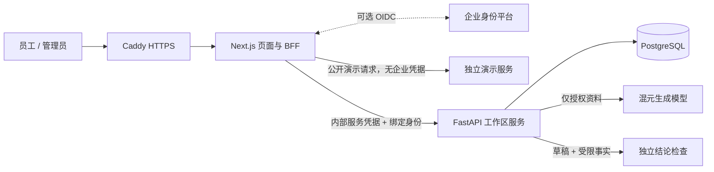

# 企业工作区

当前实现面向**单企业、单工作区的首轮部署**。企业后台使用 `BUTLER_MODE=enterprise`，首页演示由独立 `demo` 容器提供：同一网站展示演示和登录入口，后台数据库与演示数据隔离。企业 API 不加载种子资料，不开放账号选择、对比、篡改或离线评测接口。Next.js 的公开演示路由只转发到 `BUTLER_DEMO_API`，不携带企业身份或内部凭据；未设置该地址时隐藏演示。

本文件说明部署基座，不代表企业知识链路已经完成。切块、向量化、真实同步尚未实现；本次核查还复现了引用、降级输出、事实版本与评测问题，详见[实现核查与优化顺序](implementation-audit.md)。处理这些问题前，不将真实敏感资料接入生产问答。

## 应用结构



| 区域 | 页面 | 权限 |
| --- | --- | --- |
| 工作台 | 概览、问答、会话历史、可读资料 | 已登录成员 |
| 管理 | 知识导入、成员与权限、配置中心 | admin / security |
| 安全 | 审计记录与哈希校验 | admin / security / auditor |
| 独立演示环境 | 3D 演示、安全评测 | 不接企业数据 |

应用角色只决定管理能力；文档访问通过权限组与资料 ACL 的交集决定。管理员不会自动获得所有文档的问答权限。

## 首次部署

1. 准备 Docker Compose、域名、可访问的 80 / 443 端口。
2. 将根目录 `.env.example` 复制成 `.env`。保留 `BUTLER_AUTH_MODE=local`，填写域名和 `BUTLER_PUBLIC_URL=https://你的域名`；设置 `BUTLER_ADMIN_USERNAME` 与独立的 15–128 字符 `BUTLER_ADMIN_PASSWORD`，没有默认密码。
3. 分别用 `openssl rand -hex 32` 生成数据库密码、内部服务凭据和会话签名密钥。三个值独立设置。数据库密码使用十六进制，避免连接 URI 转义问题。
4. 在项目根目录执行：

   ```bash
   docker compose --env-file .env -f infra/compose.enterprise.yml up -d --build
   docker compose --env-file .env -f infra/compose.enterprise.yml ps
   ```

5. 首次启动创建管理员后，删除 `.env` 中两个 `BUTLER_ADMIN_*` 值，并重建 API 容器，移除运行环境中的初始密码。初始化只执行一次，不会在重启时覆盖密码、恢复停用账号或重新授予权限。
6. 管理员用账号密码登录，在「成员与权限」创建员工账号并分配角色、权限组。员工在「账号设置」修改自己的密码，忘记密码由管理员重置。新账号默认 employee、无资料权限；不开放公开注册。
7. 在「配置中心」填写生成模型、安全检查模型的实际模型 ID；API 服务通过 `LLM_API_KEY` 获得凭据，服务地址通过 `LLM_BASE_URL` 设置（任何 OpenAI 兼容的服务：混元、GPT、各类路由服务），必须是 HTTPS；旧的 `HUNYUAN_API_KEY` / `HUNYUAN_BASE_URL` 仍然有效。新一代 GPT 模型要求 `max_completion_tokens`、不接受自定义 temperature，客户端会在收到 400 后自动调整。**密钥只放在服务端环境变量或环境密钥里，不要贴进聊天、截图或仓库。**
8. 在「知识资料」导入资料和受限事实，再执行真实账号问答和撤权验收。

本地开发可以通过 Sara 的「成员与权限」创建本地账号，退出后使用账号密码登录。演示账号选择收在登录页的「体验演示账号」中。

### 可选：标准 OIDC

API 和 Web 同时设置 `BUTLER_AUTH_MODE=oidc`，填写 `BUTLER_OIDC_ISSUER`、`BUTLER_OIDC_CLIENT_ID`、`BUTLER_OIDC_CLIENT_SECRET`，并从身份平台查询首位管理员的 `BUTLER_BOOTSTRAP_ADMIN_SUB`，不能用显示名或未校验邮箱替代。

在身份平台登记回调 `https://你的域名/auth/callback`，允许 authorization code + PKCE S256，签名支持 RS256 / PS256 / ES256。默认 client_secret_basic，需要时设置 `BUTLER_OIDC_CLIENT_AUTH_METHOD=client_secret_post`。OIDC 与本地账号各有独立身份，不按同名合并权限。OIDC 模式关闭本地密码入口与创建、重置接口。

数据库和 API 没有宿主机公开端口。浏览器只能访问 Next.js BFF；BFF 不接受浏览器指定提问身份。服务间凭据仅供内部调用，不能发给用户。

OIDC 新成员首次登录后自动登记为 employee，权限组为空；指定 subject 仅在首次创建时获得管理员权限。停用账号每次请求重新检查；停用与重新启用均提升会话版本，旧登录不会恢复。登录会话最长 8 小时；OIDC 的本地退出不终止身份平台会话。

本地密码使用独立随机盐与 Argon2id（64 MiB、3 轮、并行度 1），凭据不出现在成员列表、响应或审计中。修改或重置密码提升会话版本，使原有登录失效。单账号 15 分钟内最多尝试 5 次，全工作区每分钟最多 30 次，计数持久化；未知账号不创建限流记录。全局限流可能影响多人同时登录，扩容前应增加网关按来源限流。当前没有 MFA、泄露密码筛查、自助邮件找回或临时密码强制改密。

## 持久化和安全行为

- 配置、成员、资料、受限事实、会话与审计写入数据库，服务重启保留。
- 资料导入在同一事务内完成；事实 ACL 继承其来源文档。更新资料权限同步更新事实权限。
- 资料内容或 ACL 更新、账号权限组变化后，旧会话不再返回历史回答；继续提问需新建会话。
- 模型和检查器必须同时配置。企业模式没有规则生成器回退；模型失败、检查失败或判定格式不完整时不发出草稿。
- 每个会话最多 30 轮；模型上下文与检查输入各有 60,000 字符上限，超限返回错误。当前检索是字符二元组检索，尚非向量召回。
- 审计记录问题哈希、引用编号与判定，不写问题正文；会话表保存问答正文，应按企业数据处理要求限制数据库访问及备份。
- 应用修改与问答使用数据库事务和行锁保持审计顺序。当前按单 API worker 运行，模型调用会持有工作区锁，适合首轮小规模验收；扩容前需拆分请求队列、会话锁与审计追加事务。

## 资料导入

管理页提供示例下载。JSON 格式：

```json
{
  "documents": [
    {"id": "policy-001", "source": "upload", "title": "报销制度", "text": "每月 25 日前提交。", "acl": ["employees"]},
    {"id": "finance-001", "source": "upload", "title": "预算安排", "text": "项目 A 预算将缩减。", "acl": ["finance"]}
  ],
  "facts": [
    {"id": "budget-reduction", "source_doc": "finance-001", "statement": "项目 A 预算将缩减。"}
  ]
}
```

同编号更新，当前没有删除接口。单次最多 200 份文档、500 条事实、2 MB。受限事实当前由管理员维护，尚未自动抽取。角色配置和资料 ACL 使用相同的权限组名称。

## 上线前仍需完成

这份部署配置可作为企业联调基座，**不代表已经完成生产验收**。

- 在实际身份平台上验证账号停用、登录失败、角色回收和会话到期；当前自动测试使用签名测试令牌，不是真实租户。
- 使用实际混元账号验证生成与检查效果，补充企业自己的攻击与正常问题评测。已有离线 30+30 结果不能外推到真实模型。
- 实现 Slack / Atlassian / Drive 连接器、权限同步、撤权事件、同步游标及失败重试。当前只支持带 ACL 的管理员导入，管理页不会假称平台已连接。
- 将审计签名检查点存到库外。当前数据库内哈希链可检测记录变更，但不能防止有数据库写权限的人同时重写记录和检查点。
- 建立数据库备份与恢复演练、保留 / 删除策略、部署密钥轮换、限流和监控；扩容前替换当前整工作区串行请求锁。
- 增加版本化数据库迁移。当前首次启动使用 SQLAlchemy 创建初始表；后续结构变化需显式迁移，不能依赖自动建表升级。
- 多租户部署需显式 tenant_id 与数据库 / 索引隔离。本版为单企业独立实例，不提供共享数据库的多租户隔离。
- 认证和权限改动需按 [WORKSPLIT.md](WORKSPLIT.md) 安排另一位维护者复核；本次尚未进行独立人工安全审查。

## 本次验证范围

后端 39 项、前端 11 项认证、权限与隔离检查通过，企业模式构建通过。浏览器验证了账号创建、密码登录、修改密码、旧密码拒绝、管理员重置、手机端创建表单，以及此前的配置保存、资料检索、会话恢复与权限拒绝。企业模式不提供演示身份选择，公开演示仍经独立地址运行。

当前环境没有 Docker 引擎，未实际启动 Compose / PostgreSQL；Compose 只做了 YAML 语法检查。真实身份平台和混元调用尚未联调。自动测试里的数据库为临时 SQLite，OIDC 使用本地签名测试令牌，模型传输使用模拟响应。

复核命令：在 `services/api` 运行 `BUTLER_DEMO_DATABASE_URL=sqlite:///:memory: python -m pytest -q`；项目根目录运行 `npm --prefix apps/web run test:security` 和 `BUTLER_MODE=enterprise npm --prefix apps/web run build`。

## 参考

- [OpenID Connect Core](https://openid.net/specs/openid-connect-core-1_0.html)
- [jose：JWT 验签与 JWKS](https://github.com/panva/jose)
- [腾讯混元兼容接口](https://cloud.tencent.com/document/product/1729/111007)
- [OWASP Password Storage](https://cheatsheetseries.owasp.org/cheatsheets/Password_Storage_Cheat_Sheet.html)
- [OWASP Authentication](https://cheatsheetseries.owasp.org/cheatsheets/Authentication_Cheat_Sheet.html)
