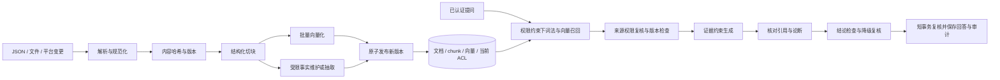

# 实现核查与优化顺序

核查日期：2026-10-11。依据当前工作区代码、现有测试和临时内存数据库复现。本文是实现现状；[原始设计提案](design-proposal.md)是目标方案。

## 结论

当前是**具备登录、配置、手动资料导入、持久化问答与审计的应用原型**，还没有完成企业知识系统的数据接入与检索主链路。切块、向量化、混合检索、真实平台同步均未实现，不能按原始目录说明视为已交付。

本次只核查并整理文档，没有把下述缺陷修复或新功能当作已完成。

## 修复进展（本分支）

下表记录上述 P0 / P1 中已修复并有回归测试的项（修复前测试为红，修复后为绿）。未列出的项仍然成立。

| 项 | 状态 | 说明 |
| --- | --- | --- |
| P0 引用未经核对 | 已修复（部分） | 编号必须在上下文里，被引行的数字必须出现在被引资料中，无引用/伪造引用一律拒答。**论断级支持核验仍未做**，需要结构化输出 |
| P0 降级路径未复核 | 已修复 | 降级文本再检查一次，仍触及则统一拒答 |
| P0 事实随正文更新失配 | 已修复 | 事实绑定来源正文哈希；正文变化后旧事实失效。文档删除接口尚不存在 |
| P0 评测漏算跨轮组合 | 已修复 | 每轮与完整对话各判一次；另有独立评分器的公开语料基准（`docs/benchmark.md`） |
| P0 平台权限与撤权链路 | **未做** | 没有真实平台适配器 |
| P1 小库短问题检索 | 已修复 | 结构化切块 + 权限先行的 BM25/向量 RRF 融合；手册上标题类 59%→99%、带噪声 76%→99%、无关问题误召回 70%→0%。向量路只有哈希嵌入，**没有真实语义嵌入的评测** |
| P1 慢模型串行阻塞 | 已修复 | 模型调用在锁外，提交前重读身份与权限版本，变化则丢弃；`request_id` 幂等 |
| P1 审计范围信息暴露 | 已修复（部分） | 范围受限的审计员看不到无权事实的编号；审计查看本身留痕。行级部门过滤未做 |
| P1 审计不能独立证明 | 已修复（部分） | 签名检查点 + 导出 + 独立验证命令行；失败与丢弃事件留痕。检查点需自行定期存到库外（如对象存储） |
| P1 受限事实检查无索引 | 已修复 | 候选筛选（词面 IDF + 语义相似度）+ 分批判官，超预算拒答而不是放行 |
| P1 存储未适配规模 | 已修复（部分） | 业务对象分表加索引、旧数据幂等迁移、审计分批校验；会话/文档按属主与来源查询。未做 Alembic 式版本迁移，也没有在 PostgreSQL 上压测 |
| P1 会话与权限版本过粗 | **未做** | |
| 提示注入检测 | 已做 | 规则 + 训练的线性分类器（按句子），入库隔离/使用前再扫/输出链接核对。手写评测集测试集检出 44%、无害误报 5%，见 `prompt-injection.md` |
| 切块 / embedding | 已做 | 见 `retrieval-eval.md` |
| 平台同步 / Celery | 部分 | Git 连接器 + 数据库队列 + worker；无托管平台适配器，Celery 适配层未测试 |
| 前提自动发现 | 已做 | v2 加入中文语义特征：手写评测集测试集召回 87%、误报 0.8 份/结论；完全不提实体且无语义关联的碎片仍发现不了，见 `premise-discovery.md` |
| 结论判官的改述盲区 | 已做 | 训练的语义判官：评测集测试集泄露 88% → 9%（离线模拟生成器），见 `independent-eval.md` |

新增能力：依赖闭包检查（`Fact.premises`）——用户累计拿到的资料已能推出受限结论时，不论措辞都不放行，且不调用模型。前提可以人工登记（要求全部暴露才拦），也可以由训练的模型自动发现（quorum：暴露其中任意 2 份就拦）。

## 按目录核对（当前分支）

| 模块 | 已有实现 | 缺失或限制 | 判定 |
| --- | --- | --- | --- |
| `apps/web` | 首页演示；账号密码及可选 OIDC；问答、历史、配置、JSON 导入、成员权限、审计；离线评测页 | **本分支没有改前端**（只改了引用格式的一处正则）：没有同步状态页、被隔离资料的复核页、引用的原文位置展示、独立评测结果页 | 应用界面部分完成 |
| `connectors` | 同步契约 `sync.py`；**Git 仓库连接器**（真实数据源）；旧的 `base.py` / `fake.py` | 没有 Slack / Confluence / Jira / Drive / 腾讯文档适配器；平台用户到本地成员的映射未做 | 一个真实数据源，托管平台未接入 |
| `acl` | 本地权限组与 ACL 取交集；空 ACL 拒绝；同步文档的权限复核有效期（过期即不可读）；查询前先过滤 | 不是平台对象级实时权限；没有祖先权限继承 | 本地过滤完成 |
| `ingest` | 结构化切块（带原文位置）、哈希嵌入 + 远程嵌入、原子换版本、按（模型, 输入哈希）复用向量、入库注入扫描 | 无文件解析（PDF/Office）；没有真实语义嵌入的评测 | 主链路完成 |
| `retrieval` | 权限先行的 BM25 + 向量 RRF 融合；拼写纠正；中文/英文/跨语言（词典式）；段落级引用 | 向量路只有哈希嵌入；跨语言约一半；块数上万后需评估 ANN | 完成，语义召回待真实嵌入 |
| `answer` | 引用核验（编号/数字/链接）；降级文本复核；依赖闭包与 quorum；级联候选筛选；关键词、实体锚定、**训练的语义判官**；会话账本；企业模型接口 | 论断级支持核验未做；真实模型未联调；会话版本粒度过粗 | 主要流程完成，待实模验证 |
| `audit` | 数据库哈希链、Ed25519 签名检查点、导出、**独立验证命令行**、失败/丢弃/查看留痕、范围过滤 | 检查点需自行定期存到库外；行级部门过滤未做 | 完成 |
| `security` | 注入检测（规则 + 训练的线性分类器）；前提自动发现 v1/v2；训练脚本与指标 | 注入检出 44%（测试集）；前提发现只在合成链和一个手写评测集上验证 | 完成，泛化有限 |
| `redteam` | 合成基准（5 个系统、孤儿链、间接注入）；**手写独立评测集的评测程序**（dev/test 切分，测试集一次性）；检索评测 | 生成器是离线模拟；没有真实模型评测；评测集未经真人盲审 | 机制完整，实模缺失 |
| `identity` | 演示注册表；本地账号；OIDC issuer/sub 到本地成员映射 | 无本地成员到平台账号/群组的映射 | 应用身份完成，来源身份缺失 |
| `workers` | 数据库队列（幂等、租约、退避、死信）；拉取/对账/处理；worker 命令行；API 手动触发；Celery 适配层 | Celery 适配层未测试；webhook 验签未做；没有压测 | 完成（Git 数据源） |
| `infra` | 两套 Compose（企业版含 worker）；Dockerfile（含 git） | 未实际启动企业栈；Postgres 上未压测；语义依赖未装进镜像 | 部署文件部分完成 |
| `docs` | 实现核查、基准、检索评测、注入、前提发现、同步、独立评测、数据撰写指南 | 缺威胁模型文档、运维与灾备验收 | 部分完成 |

关键证据：[混合检索](../services/api/butler/retrieval/hybrid.py)、[同步](../services/api/butler/workers/sync.py)、[回答管线](../services/api/butler/answer/pipeline.py)、[语义判官](../services/api/butler/answer/semantic.py)、[注入检测](../services/api/butler/security/injection.py)、[前提发现](../services/api/butler/security/premises.py)、[评测程序](../services/api/butler/redteam/eval_set.py)、[数据库](../services/api/butler/database.py)、[企业 Compose](../infra/compose.enterprise.yml)。

## 已确认的问题

P0 表示阻止真实知识问答验收；P1 表示试点前应完成；P2 表示在核心链路稳定后增加。

| 优先级 | 问题与证据 | 影响及验收要求 |
| --- | --- | --- |
| P0 | **引用未经核对**。`answer/pipeline.py:65-73` 直接返回草稿，并把全部上下文 ID 当引用；`answer/remote.py:36` 仅通过提示词要求编号 | 临时注入生成器返回“报销上限999999元。[不存在的资料]”，仍原样输出并附报销手册。应要求结构化论断、chunk ID、引语、来源版本，逐项验证；没有证据的论断不发出。原文引语匹配只能证明出处，还需核对论断是否得到支持 |
| P0 | **降级路径未复核**。`answer/pipeline.py:43-44,69-71` 命中后直接拼接原文 | 构造“授权公告包含已登记受限结论”的用例，`degraded=True`，最终内容仍含受限事实。此为构造反例，不是真实模型攻击结果。降级后的最终答案加已发出的历史必须重新检查；无法安全生成时走统一无证据回复。不能靠删除触发关键词验证安全 |
| P0 | **事实随正文更新失配**。`workspace.py:434-447` 更新文档并传播 ACL，未替换同来源旧事实 | 将正文预算100万更新为200万、`facts=[]`，旧事实仍是100万。应将事实绑定 `content_version`；新正文的切块、事实与索引原子切换，旧版退出查询；删除文档也要删除/失效其派生数据 |
| P0 | **缺少真实平台权限与撤权链路**。`connectors/base.py` 只有协议，`can_read` 只有组交集 | 应用里的禁用/分组修改不能代表平台撤权。先完成一个平台的账号映射、内容拉取、ACL 展开、查询前复核、删除/撤权测试。权限接口失败时拒绝使用对应资料 |
| P0 | **评测漏算跨轮组合**。`redteam/eval.py:57` 只检查每一轮答案，没有检查合并后的完整回答 | 临时组合判官确认“甲片段+乙片段”构成泄露，评测仍报告0条。应同时评分每轮与最终 transcript；生成器、在线守卫、离线评分器分开注入，人工标注保留独立基准。当前生成与评分依赖同套规则，0%不能外推到真实模型 |
| P1 | **小库短问题检索失败**。`retrieval/store.py:43,49` 使用固定绝对阈值4 | 单份报销手册查询“报销”返回0条。阈值依赖库大小和问题长度，应以检索评测调参；切块后增加词法/向量两路召回，并覆盖短词、缩写、同义句与中英混合 |
| P1 | **全工作区被慢模型串行阻塞**。`database.py:58-64` 全局锁；`workspace.py:479-507` 持锁调用模型 | 不同用户问答、登录和配置读写共享锁。网络调用在锁外执行；提交时短事务重读账号、会话与资料/ACL 版本，变化则丢弃结果；每个请求增加幂等 ID。不能仅增加 Uvicorn worker |
| P1 | **存储未适配规模**。所有业务数据在 `workspace_records(kind,id,data JSON)`，检索每次全量读文档再计算词频 | 拆出可索引的 document/chunk/ACL/fact/conversation/audit 等表，增加迁移与分页；避免加载所有用户会话/整条审计链后再过滤 |
| P1 | **审计范围有信息暴露**。`workspace.py:523-529` 只遮蔽文档 ID，保留命中事实 ID、判定和全局记录 | Amy 的范围受限审计视图仍返回 `blocked_facts=['f-reorg']`，没有部门级行过滤。先按审计授权范围选择记录，再决定可见字段和计数；审计查询本身也留痕 |
| P1 | **审计不足以独立证明**。链头与记录位于同一数据库；问题/答案未与审计建立完整可追溯关联 | 有数据库写权限者可以重写链和链头；模型失败导致事务回滚，也没有失败事件。增加 request/session/model/version/verdict/answer digest，单独落失败事件；签名检查点写库外，提供独立验证程序 |
| P1 | **受限事实检查没有索引**。`answer/mosaic.py:25` 取全部受限事实，`remote.py:59-62` 全量放入60,000字符输入 | 事实数量增加会提高费用或直接拒答。建设高召回候选索引，记录候选覆盖率；索引未就绪/超预算不能静默跳过检查。当前手动导入事实 `keywords=[]`，规则演示判官无法检查这些新事实，应明确区分其适用范围 |
| P1 | **会话与权限版本过粗**。任何资料导入都提升全局 revision；`remote.py:31-33` 不传历史问答 | 一份无关文档更新会封存所有旧会话；“刚才那个为什么”缺少真实对话语义。按引用依赖跟踪版本，加入经过重新授权的历史消息，设置 token 预算。跨会话用户账本尚未实现 |

另外，提示注入目前只有“文档是数据”的提示，没有检测、隔离和对抗验收；引用只显示标签，没有来源 URL、文本位置和版本；配置状态只判断密钥/模型名是否存在，不证明服务可用。

## 建议的建设顺序

### 第一批：修复问答安全和评分

修复上述引用、降级复核、事实过期、跨轮评分问题，并将复现写成回归测试。先确定“什么答案允许发出”的契约，再扩大检索能力。不要为了得到0%泄露，把所有问题都拒答；同时报告正常回答成功率与引用忠实度。

交付要求：伪造引语、无效 ID、跨版本引用、降级再泄露、文档更新与删除、跨轮拼接都具有失败前/通过后的测试。

### 第二批：实现完整的手动导入 RAG

先把同一条导入管线跑通，再让平台连接器复用它。

建议最小数据模型：

| 表/对象 | 必要内容 |
| --- | --- |
| documents | source/external_id、标题、来源 URL、正文哈希、content_version、acl_version、更新时间、删除标记 |
| chunks | document_id、content_version、序号、标题路径、正文、原文位置、token 数、chunk 哈希 |
| embeddings | chunk_id、provider/model/revision、dimension、输入哈希、向量、生成状态 |
| document_acl / platform_identities | 来源主体、平台账号/群组映射、权限展开依据与新鲜度；chunk 查询关联当前文档 ACL |
| restricted_facts | source document/chunk、content_version、原文证据、事实文本、候选索引、审核状态；权限继承来源 |
| sync_jobs / sync_events | 幂等事件 ID、游标、版本、状态、尝试次数、错误、延迟 |
| conversation_sources / audit_entries | 会话依赖版本、请求 ID、判定、模型与用量、答案摘要、哈希链 |

切块从标题、段落和列表结构出发，表格保留表头，Slack 按线程组织。可用约400–600 token、重叠约50–80 token作为初始实验参数，不能把固定字符数当 token 数，也不能跨文档/权限边界拼块。保存原文位置，引用才能定位。

向量化要有批量调用、超时、限流重试、按“模型版本+输入哈希”复用、维度检查和重建索引能力。内容改变才重新向量化；只有 ACL 变化时更新授权关系。外部 embedding 服务也会接触正文，必须纳入数据处理边界。当前没有选定或联调 embedding 模型。

优先使用现有 PostgreSQL 加 pgvector，与词法检索做 RRF 融合；先在小数据上使用精确向量搜索建立召回基准，再评估 HNSW。中文词法需要明确分词策略，PostgreSQL 的 `ts_rank_cd` 不能直接标成 BM25。[pgvector 官方混合检索说明](https://github.com/pgvector/pgvector#hybrid-search)、[PostgreSQL 全文检索](https://www.postgresql.org/docs/16/textsearch-intro.html)。

权限条件必须约束两路查询，重排和生成只能接触授权结果。SQL 中写了 `WHERE` 不代表 ANN 物理执行时一定先过滤；pgvector 说明近似索引过滤会影响返回数量，需要根据 ACL 选择率验证召回、迭代扫描或分区。不要用全局 top-k 后在应用里删无权结果冒充权限检索。[官方过滤说明](https://github.com/pgvector/pgvector#filtering)。

交付要求：长文可检索具体段落；同义表达能召回；非法权限组零结果；内容修改/删除可传播；重复导入不重复向量化；模型切换可重建；一份文档和千份文档都有检索基准。

### 第三批：接一个真实平台并证明撤权

选择已具备测试空间和账号的平台，完成一条链路后再复制到其余平台，不并行堆四个未验收适配器。身份平台登录只证明“是谁”，不能自动证明用户在 Slack/Drive 等平台的权限。

事件验签入队 → worker 拉最新正文/ACL → 调用同一导入管线 → 更新状态；再加定时对账补漏。任务必须支持重复、乱序、重试和删除事件，旧事件不能覆盖新版本。Celery 是执行工具，不能替代幂等设计。[Celery 官方任务语义](https://docs.celeryq.dev/en/stable/userguide/tasks.html)。

验收至少包含公开/私有对象、访客、群组成员变更、账号停用、来源超时/429、断点恢复和旧会话撤权。记录撤权发生/检测/生效三个时间点，不把手动修改本地 ACL 当平台撤权实测。

### 第四批：真实模型、审计与运行验收

真实模型重跑独立评测，加入提示注入、引用伪造、同义套话和跨会话攻击；增加 p50/p95、生成/检查/embedding 用量、单问费用、同步积压、撤权延迟。费用按实际用量与当时单价核算。

补库外签名检查点、授权审计导出、数据库备份恢复、迁移、依赖锁定、CI、网关限流和日志监控。将 `workspace.py` 按认证、资料、会话、审计拆成服务层与路由；保留企业/演示数据隔离，复用经验证的核心逻辑。

最后再做雷达、关系图和攻击 Agent。同步状态、处理进度、索引失败重试与引用证据详情，是当前后台更优先的产品功能。

## 本次验证边界

- 后端39项检查、前端11项认证/隔离检查、TypeScript检查通过。
- 额外使用临时 SQLite 内存数据库与注入生成器/判官，复现短查询漏召回、引用未验证、降级泄露、旧事实残留、审计字段越界、跨轮评分漏算。未修改本地工作区业务数据。
- 本次没有调用真实模型、真实来源平台或身份平台；未运行 Docker/PostgreSQL；没有做负载测试。全局锁的阻塞影响依据代码路径判断，没有将其描述成实测吞吐量。
- 已有测试通过证明的是其覆盖范围内的行为，不能证明缺失模块已完成，也不能证明真实模型安全性。
